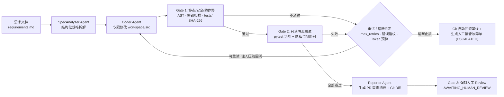

# Agent SDLC Orchestrator

> **面向真实研发流水线的确定性状态机（FSM）AI 研发编排框架与工程落地方案**  
> Deterministic FSM-orchestrated AI R&D pipeline with multi-stage quality gates, anti-tamper read-only test isolation, circuit-breaker Git rollback, and Human-in-the-Loop PR review.

- **技术栈：** Python 3.10+ · Pydantic v2 · Pytest · Git Sandbox · DeepSeek API (`deepseek-flash` / `deepseek-v4-pro`) · Ollama
- **核心定位：** 用“**确定性编排器 + 单职责子 Agent + 物理隔离质量门禁**”替代不可控的自由对话多 Agent，在保障代码安全、隐私合规与成本可控的前提下，打通 `读需求 → 写代码 → 静态/安全/防作弊门禁 → 只读隔离测试 → 自动修复或熔断回滚 → 人工 Review 报告` 研发闭环。

---

## 一、核心工程亮点

1. **确定性有限状态机（FSM）编排，而非失控的自由对话 Swarm**
   - 自研轻量编排引擎（`mvp/orchestrator/engine.py`），显式管理 `INIT → ANALYZING_SPEC → GATING → REPAIRING → AWAITING_HUMAN_REVIEW / ESCALATED_TO_HUMAN` 状态流转，全链路可审计、可复现。
2. **编写权与验收权物理分离（Anti-Tamper 防作弊门禁）**
   - `CoderAgent` 仅拥有沙箱内 `src/` 目录写权限（内置路径逃逸防护）；Gate 1 对只读验收测试目录 `tests/` 执行 SHA-256 完整性校验，一旦检测到 Agent 试图篡改或删除测试用例以骗过门禁，立即触发 `ANTI-TAMPER-001` 阻断并熔断。
3. **多级确定性质量门禁（Gate 1 + Gate 2 + Gate 3 Human Gate）**
   - **Gate 1（静态与安全扫描）**：AST 语法校验、拦截 `eval`/`exec`/`os.system`/`subprocess(shell=True)`、正则拦截硬编码 API Key 与生产库连接串、防作弊哈希校验。
   - **Gate 2（只读隔离测试）**：子进程超时隔离执行 `pytest`，提取压缩失败回溯（上限 2,800 字符防止上下文腐化）并计算稳定错误指纹（Error Fingerprint）。
   - **Gate 3（强制人工 Review）**：终态锁定 `AWAITING_HUMAN_REVIEW`，输出含标准 `git diff`、人工核查清单与消耗账单的 PR 审查报告，严禁自动合入主干或触碰生产环境。
4. **防卡死熔断与 Git 自动回滚兜底**
   - 同时具备 `max_retries` 重试上限、`DUPLICATE_ERROR_FINGERPRINT` 连续相同错误指纹去重熔断、`token_budget` 成本上限熔断；触发熔断后自动执行 `git reset --hard` 回滚至安全基线并生成结构化人工接管单（`EscalationTicket`）。
5. **国内网络友好的多后端模型路由与精确人民币成本计量**
   - 原生对齐 DeepSeek 最新官方模型规范（`deepseek-flash` / `deepseek-v4-pro`，Base URL `https://api.deepseek.com`），支持按北京时间峰谷时段与缓存命中（`prompt_cache_hit_tokens`）自动核算人民币成本，同时兼容通用 OpenAI-Compatible 接口、本地免费 Ollama 与零依赖 `mock` 离线复现模式。

---

## 二、系统架构



---

## 三、真实模型实测表现（`deepseek-flash`）

以大型体育赛事影像服务平台（如爱云动）的**「赛事影像上传与号码布识别流水线巡检工具」**为业务场景，覆盖选手肖像下架过滤（`opt_out`）、手机号与原图签名 URL Token 脱敏及脏日志容错等真实合规红线：

| 演示场景 | 模型后端 | 基线门禁 → 终态门禁 | 终态 | 总 Tokens（含缓存命中） | 实测耗时 | 实测成本（高峰时段） |
| :--- | :--- | :---: | :--- | ---: | ---: | ---: |
| `repair_demo`（自动修复闭环） | `deepseek-flash` | `2/5 FAIL` → **`5/5 PASS`**（首轮修复通过） | `AWAITING_HUMAN_REVIEW` | 13,425（0） | 38.20s | **¥0.0728** |
| `escalation_demo`（规格冲突熔断） | `deepseek-flash` | `1/2 FAIL` → 坚守隐私红线触发重复指纹熔断并 Git 回滚 | `ESCALATED_TO_HUMAN` | 24,651（640） | 86.23s | **¥0.1488** |
| `mock` 离线对照（双场景） | `mock-deterministic-v1` | `2/5 → 5/5` & `1/2 → 熔断回滚` | 全部按预期收口 | 16,807（0） | 3.94s | ¥0.0000 |

- 编排器安全与防作弊单元测试：`python -m pytest -v mvp/tests/` — **4/4 PASSED**（覆盖高危 AST 拦截、硬编码密钥拦截、只读测试防篡改、双场景端到端闭环）。

---

## 四、快速开始（一条命令运行）

### 1. 安装极简依赖

```bash
pip install -r mvp/requirements.txt
```

### 2. 一条命令离线复现（无需 API Key，3 秒跑通双场景）

```bash
python mvp/run_pipeline.py --scenario all --provider mock
```

### 3. 接入 DeepSeek API 实测（国内网络直连）

```bash
cp mvp/.env.example mvp/.env
# 在 mvp/.env 中填入你的 DEEPSEEK_API_KEY
python mvp/run_pipeline.py --scenario all --provider deepseek
```

### 4. 运行编排器安全与门禁单元测试

```bash
python -m pytest -v mvp/tests/
```

---

## 五、仓库结构导航

| 路径 | 内容说明 |
| :--- | :--- |
| [docs/AI研发团队组建方案.md](docs/AI研发团队组建方案.md) | 完整 7 章企业级 AI 研发团队落地蓝图（角色分工、工具链架构、存量系统知识化、6 级质量门禁、误修复率评估、80 万/年预算精算、12 个月里程碑与红线治理） |
| [mvp/](mvp/) | 自研 FSM 编排引擎源码、爱云动双演示场景、安全/防作弊单元测试与详细使用文档（见 [mvp/README.md](mvp/README.md)） |
| [EVIDENCE.md](EVIDENCE.md) | 方案与 MVP 对应关系表、真实 `deepseek-flash` 运行日志、失败响应与熔断回滚实录、精确 Token/人民币账单及引用清单 |
| [docs/录屏演示脚本.md](docs/录屏演示脚本.md) | ≤4 分 30 秒结构化架构讲解与终端实操演示分镜脚本 |
