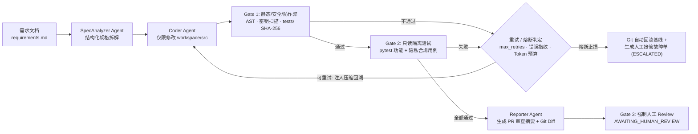

# Agent SDLC Orchestrator

<p align="left">
  <a href="LICENSE"></a>
  <a href="CONTRIBUTING.md"></a>
  
  
  
  
</p>

> **面向真实企业研发流水线的确定性状态机（FSM）AI 研发编排框架与产品落地方案**  
> Deterministic FSM-orchestrated AI R&D pipeline with multi-stage quality gates, anti-tamper read-only test isolation, circuit-breaker Git rollback, and Human-in-the-Loop PR review.

- **核心问题（Problem Statement）：** 传统软件研发团队常面临“人力有限、存量系统多、内部工具与排障需求严重积压”的瓶颈；而直接引入自由对话式多 Agent 又容易陷入**改坏旧代码、偷改测试作弊、死循环烧 Token、越权触碰生产**的失控风险。
- **产品解法（Solution）：** 采用“**确定性状态机编排 + 单职责子 Agent + 物理隔离质量门禁 + 强制人工审批**”架构，把 AI 编码约束在安全、可回滚、可量化的工程边界内，将内部工具交付周期从 **6 周压缩至 2 周**。

---

## 一、适用场景与产品边界（Use Cases & Non-Goals）

从产品与工程 ROI 视角，清晰界定本框架的**高收益适用场景**与**明确不适用红线**：

### 1. 高价值适用场景（Best Fit）

| 场景类别 | 典型业务案例（以体育赛事影像平台为例） | 输入契约 | 交付产物与核心价值 |
| :--- | :--- | :--- | :--- |
| **内部运维与排障工具** | 赛事影像上传与号码布 OCR 流水线异常巡检脚本（本仓 MVP 实测场景） | 结构化需求文档 + 脱敏日志样本 + 只读验收测试 | 自动化编码与隐私合规校验，将临时排障脚本交付从数周压至天级 |
| **数据清洗与对账报表** | 摄影师赛后上传量统计、稿费对账、赞助商水印模板批量生成 | 明确输入输出 Schema 与边界规则 | 释放人类研发脱离重复数据脚本，单次运行模型成本 < ¥0.25 |
| **隐私与合规防线补齐** | 选手肖像下架申诉（`opt_out`）拦截、手机号与签名 URL Token 脱敏加固 | 历史线上 Bug 沉淀的只读黄金回归测试集 | 确保合规规则 100% 机器验证通过，杜绝人工疏漏导致 PII 泄露 |
| **存量中低复杂度需求清积压** | 内部管理后台常规字段扩展、接口参数校验、单元测试与文档补全 | 仓库 `AGENTS.md` + 4 段式结构化 Issue | 系统性消化 3 个月以上历史需求积压，并保持统一代码质量门禁 |

### 2. 明确不适用场景（Non-Goals / 红线禁区）

- **核心资金结算与账务写链路**：涉及财务记账、支付扣款、权限体系变更的高危模块，Gate 0 阶段直接拦截转纯人工研发。
- **直接操作生产环境**：本框架严禁向任何 Agent 注入生产库凭据、SSH 密钥或发布系统写权限，所有合并与发布必须由人类审批触发。
- **零验收标准的模糊探索型需求**：缺少清晰输入输出契约或无法编写确定性测试的开放式探索任务，需先经人工需求澄清后再入流水线。

---

## 二、量化指标与实测数据（Metrics & Benchmarks）

### 1. 产品级北极星与组织效能目标（12 个月落地方案）

基于“现有 20 人研发维护 6 个内部系统、初期预算 80 万/年、周期 12 个月”的真实企业约束设定可审计 KPI：

| 指标维度 | 指标名称 | 现状基线 (M0) | 试点期目标 (M6) | 稳定期目标 (M12) | 量化收益 / 控制红线 |
| :--- | :--- | :---: | :---: | :---: | :--- |
| **北极星效率** | 内部工具端到端交付周期 | 6 周（30 工作日） | ≤ 3 周 | **≤ 2 周（10 工作日）** | **提速 3x（周期缩短 66.7%）** |
| **需求吞吐** | 历史需求积压消化 | 积压约 3 个月 | 压至 1.5 个月内 | **滚动清零** | 常规排队 ≤ 2 周 |
| **流水线健康** | 自动化门禁首次通过率（含 2 轮内自修复） | N/A | ≥ 65% | **≥ 80%** | 监控需求颗粒度与上下文质量 |
| **交付质量** | 人工 Code Review 一次合入率 | ~75% | ≥ 70% | **≥ 85%** | 降低人工返工与 Review 疲劳 |
| **防回退质量** | **误修复率（False Fix Rate）** | N/A | ≤ 8% | **≤ 5%** | 只读黄金测试集 + 异构预审双控 |
| **经济与成本** | 单位内部工具需求模型 API 成本 | N/A | ≤ ¥30 / 需求 | **≤ ¥20 / 需求** | 年度总投入严格锁定 **≤ ¥80 万** |

### 2. MVP 真实模型端到端实测基准（2026-11-24 `deepseek-flash` 实测）

以下数据来自本仓库 `mvp/run_pipeline.py` 直连 DeepSeek 官方 API（`https://api.deepseek.com` / `deepseek-flash`）在北京时间**工作日高峰时段**的真实运行审计记录（详见 [EVIDENCE.md](EVIDENCE.md)）：

| 实测项 / 演示场景 | 模型后端 | 门禁通过率变化 | 终态与兜底表现 | 总 Tokens（缓存命中） | 端到端耗时 | 实测成本（高峰 / 空闲 5 折） |
| :--- | :--- | :---: | :--- | ---: | ---: | :--- |
| **场景 1：`repair_demo`**<br/>爱云动赛事巡检自动修复 | `deepseek-flash` | `2/5 (40%)` → **`5/5 (100%)`**<br/>（首轮修复即全绿） | `AWAITING_HUMAN_REVIEW`<br/>输出 Diff + 8 项人工核查清单 | 13,425（0） | 38.20s | **¥0.0728** / ¥0.0364 |
| **场景 2：`escalation_demo`**<br/>隐私红线冲突熔断止损 | `deepseek-flash` | `1/2 (50%)` → 拒绝泄露明文手机号 | `ESCALATED_TO_HUMAN`<br/>指纹去重熔断 + **100% Git 无损回滚** | 24,651（640） | 86.23s | **¥0.1488** / ¥0.0744 |
| **安全与防作弊单测**<br/>`mvp/tests/test_orchestrator.py` | 确定性引擎 | **`4/4 (100%)`** | 拦截 `eval`/`os.system`/硬编码 `sk-` 密钥/篡改只读测试 | — | 4.79s | ¥0.0000 |
| **离线复现对照**<br/>`--provider mock`（双场景） | `mock-deterministic-v1` | `2/5 → 5/5` & `1/2 → 熔断回滚` | 零 Key / 无外网秒级复现全链路 | 16,807（0） | 3.94s | ¥0.0000 |

> [!TIP]
> **单位经济性观察：** 完整跑通“自动修复通过 + 越界熔断回滚”两个真实业务场景，高峰时段总算力成本仅 **¥0.22**（空闲时段约 **¥0.11**），相比传统内部排障脚本动辄 2~3 人日的人力投入，具备极高的投入产出比（ROI）。

---

## 三、核心架构与工程设计



- **确定性 FSM 编排**：状态机控制流转、重试上限、预算与回滚，单职责 Agent 只负责局部推理，杜绝多 Agent 自由对话失控。
- **编写权与验收权物理分离**：`CoderAgent` 路径锁定在 `src/`；Gate 1 对只读 `tests/` 做 SHA-256 防篡改校验，根除“删测试过门禁”作弊风险。
- **错误指纹去重熔断**：对失败用例与核心异常计算稳定哈希指纹，连续命中相同指纹立即熔断止损并 `git reset --hard` 回滚基线。
- **强制 Human-in-the-Loop**：终态严格锁定 `AWAITING_HUMAN_REVIEW`，绝不自动合并主干或触碰生产环境。

---

## 四、产品迭代计划（Roadmap）

项目按“**最小可控闭环 → 真实研发工具链集成 → 多系统知识化扩面 → 组织级平台治理**”四个版本持续演进：

| 版本 | 阶段定位 | 状态 | 核心迭代特性 | 对应产品价值 |
| :--- | :--- | :---: | :--- | :--- |
| **v1.0** | **MVP 最小可控闭环** | ✅ 已发布 | 自研 FSM 编排引擎、Gate 1 安全/防作弊门禁、Gate 2 只读隔离 `pytest`、Git 沙箱自动回滚、DeepSeek/Ollama/Mock 多后端与峰谷人民币计费、爱云动双场景实测 | 跑通端到端最小闭环，验证“自动修复”与“熔断回滚”双重安全性 |
| **v1.1** | **多文件补丁与分级模型路由** | 🚧 规划中 | 支持跨文件 Unified Diff 补丁生成；实现“首轮 `deepseek-flash` → 失败自动升级 `deepseek-v4-pro`”动态路由；接入 `ruff` / `bandit` 静态规则插件 | 覆盖真实多模块内部工具迭代，在控本前提下提升复杂任务首次通过率 |
| **v1.2** | **GitLab/GitHub CI 深度集成与知识图谱** | 📋 规划中 | 接入 Issue Webhook 自动触发；自动提 PR 并回写门禁摘要评论；定时 AST 解析生成轻量 `repo_map.json` 与仓库级 `AGENTS.md` 自动装配 | 无缝融入企业现有 Git/CI 体系，将内部工具交付周期压至 2~3 周 |
| **v2.0** | **企业多系统效能度量与治理看板** | 📋 规划中 | 汇总各任务 `report.json` 构建 Web 效能/质量/成本看板（首次通过率、熔断率、误修复率、单需求费用预警）；支持多租户配额与季度变异测试抽检 | 支撑 6+ 存量系统规模化推广与年度预算透明治理 |

---

## 五、快速开始（一条命令运行）

### 1. 安装依赖

```bash
pip install -r mvp/requirements.txt
```

### 2. 离线一键复现（无需 API Key，3 秒跑通双场景）

```bash
python mvp/run_pipeline.py --scenario all --provider mock
```

### 3. 接入 DeepSeek API 实测（国内网络直连）

```bash
cp mvp/.env.example mvp/.env
# 编辑 mvp/.env，填入 DEEPSEEK_API_KEY
python mvp/run_pipeline.py --scenario all --provider deepseek
```

### 4. 运行编排器安全与门禁单元测试

```bash
python -m pytest -v mvp/tests/
```

---

## 六、仓库导航

| 路径 | 内容说明 |
| :--- | :--- |
| [docs/AI研发团队组建方案.md](docs/AI研发团队组建方案.md) | 完整 7 章企业级 AI 研发团队落地蓝图（角色分工、架构取舍、6 系统知识工程、6 级门禁、误修复率评估、80 万/年精算与 12 个月里程碑） |
| [mvp/](mvp/) | 自研 FSM 编排引擎源码、爱云动双场景用例、安全与防作弊单元测试及详细运行指南（见 [mvp/README.md](mvp/README.md)） |
| [EVIDENCE.md](EVIDENCE.md) | 方案与 MVP 对应关系表、真实 `deepseek-flash` 运行日志、失败修复与熔断回滚记录、精确 Token/人民币账单及引用清单 |

---

## 七、开源贡献与协议（Contributing & License）

- **开源贡献：** 欢迎提交 Issue、新业务场景、门禁插件或模型适配器，详情请阅读 [CONTRIBUTING.md](CONTRIBUTING.md)。
- **开源协议：** 本项目采用 [MIT License](LICENSE) 开源，欢迎在遵循协议的前提下自由使用、改造与二次分发。
