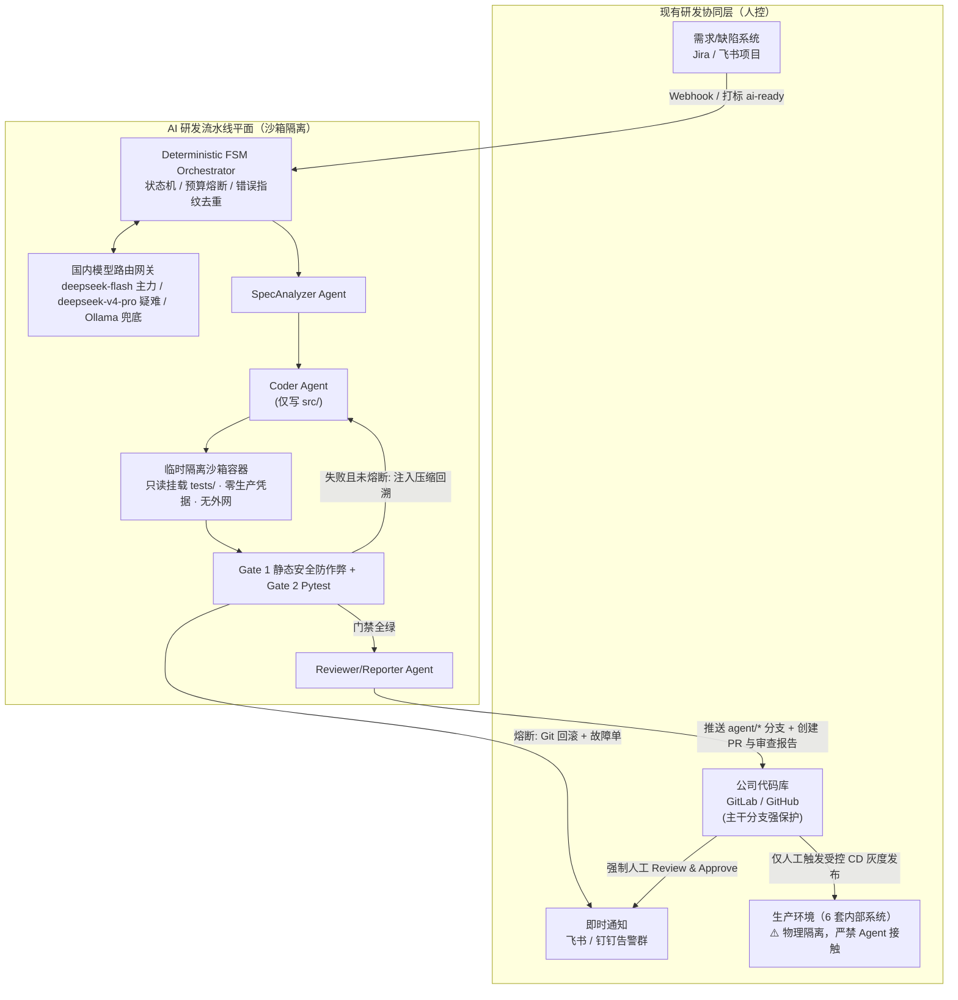
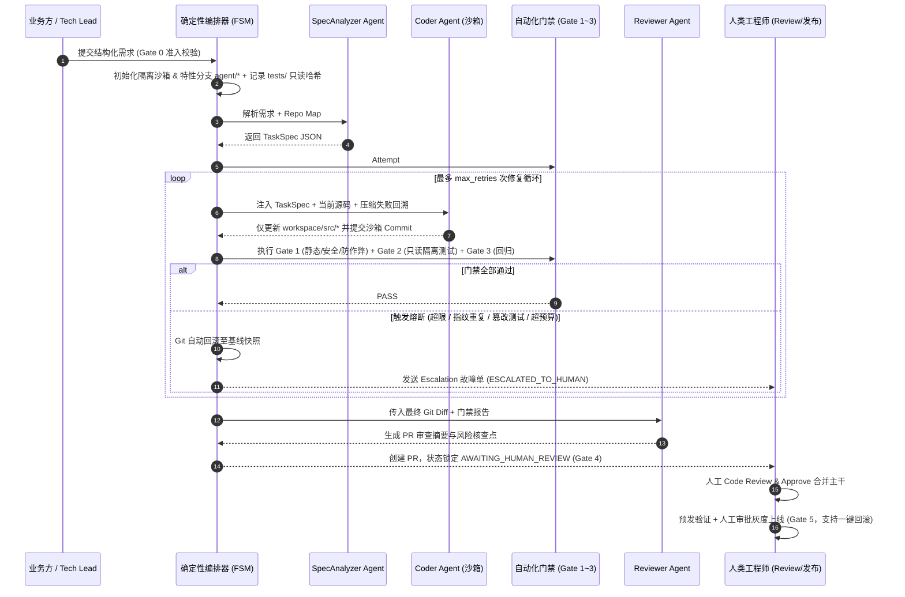

# B11 · AI 研发团队组建方案

- **题目编号：** B11 · 组建 AI 研发团队
- **方案定位：** 面向传统行业软件研发团队的“少量人类工程师 + AI Agent”工程化落地蓝图
- **业务背景说明：** 本方案严格遵循题面全部虚构约束（现有研发 20 人、维护 6 个内部系统、需求积压约 3 个月、交付周期从 6 周压缩至 2 周、12 个月周期、80 万/年初期预算），并以 **体育赛事专业影像服务与 AI 照片分发平台（如爱云动业务形态）** 具象化 6 个内部系统与落地案例，使质量门禁、隐私合规与 Part B MVP 工具形成端到端闭环验证。

---

## 第 1 章 角色配置：人机协同组织与职责边界

### 1.1 团队编制原则

在 **80 万/年（含模型 API、工具订阅、可招 2-3 人）** 的硬约束下，若盲目在外部社招 3 名资深 AI 算法工程师，仅人力成本（含企业五险一金）即会突破百万，且外部新人对存量 6 套内部系统毫无业务积累，极易陷入“模型很炫但接不进老代码库”的困境。

因此，本方案采用 **“3 名人类工程师（1 内部抽调 + 2 新招工程化）+ 1 个确定性编排器 + 4 类单职责 Agent”** 的精干编制：

### 1.2 完整角色配置表（人 + Agent）

| 角色类别 | 角色名称 | 编配 / 实现形态 | 核心职责 | 明确权限边界（禁止事项） |
| :--- | :--- | :--- | :--- | :--- |
| **人类角色** | **Tech Lead / 架构与发布守门人** | 1 人（现有 20 人中内部抽调，熟悉 6 套系统） | 复杂需求拆分与风险分级、架构规范制定、**强制人工 Code Review 与 PR 最终合入**、预发验收与生产发布审批、定期清理架构债 | 不再手写大量重复 CRUD 与内部脚本，但对所有入库代码负最终质量责任 |
| **人类角色** | **AI 工程与编排工程师** | 1 人（外部新招，中级偏平台/工程化） | 维护确定性流水线编排引擎、6 级质量门禁脚本、沙箱隔离环境、模型路由与 Token 成本监控、`AGENTS.md` 与知识索引同步 | 严禁为追求通过率放宽安全扫描或关闭人工 Review 门禁 |
| **人类角色** | **业务研发与测开工程师** | 1 人（外部新招，中级全栈/测开） | 将业务方口头诉求转化为结构化需求规格、维护 6 大系统的**只读黄金回归测试集**、处理 Agent 熔断上报（Escalation）后的兜底开发、分担日常 PR Review | 黄金验收测试集须独立归档并受分支保护，严禁交由 Coder Agent 直接修改 |
| **确定性控制层** | **Orchestrator（流水线编排器）** | 非 LLM 代码（有限状态机 FSM） | 控制全流程状态流转、Git 特性分支隔离、质量门禁调度、重试计数、错误指纹去重、Token/耗时熔断与失败自动回滚 | 不承担创意编码推理，100% 保证状态流转、预算与红线执行的确定性 |
| **Agent 角色** | **SpecAnalyzer Agent（需求研究）** | LLM（低温度结构化输出） | 读取需求文档与仓库代码符号图谱，产出标准化 `TaskSpec`（功能清单、隐私/合规约束、影响文件列表与验收标准） | 无任何代码写入与命令执行权限，输出需经 Gate 0 校验 |
| **Agent 角色** | **Coder Agent（受限开发）** | LLM（代码主力模型） | 根据 `TaskSpec` 及结构化门禁报错回溯，在隔离沙箱特性分支中编写/修复业务代码与本地文档 | **仅拥有 `src/` 业务目录写权限**；禁止修改 `tests/` 验收测试、CI 配置，禁止访问外网与生产环境 |
| **Agent 角色** | **QA / Gate 辅助 Agent** | 确定性门禁脚本 + 辅助 LLM | 确定性脚本执行静态/安全/防作弊扫描与隔离测试；辅助 LLM 根据需求草拟边界测试用例供测开工程师审核入库 | LLM 生成的测试草稿必须经人类审核后方可进入只读黄金测试库，避免“错误断言固化” |
| **Agent 角色** | **Reviewer / Reporter Agent** | 异构 Prompt / 独立上下文 LLM | 对通过自动化门禁的 `git diff` 进行风险预审（检查硬编码绕过、脱敏遗漏、复杂度膨胀），生成面向人类 Reviewer 的审查摘要与消耗账单 | **无 PR Approve 或合并权限**；输出终态强制锁定在 `AWAITING_HUMAN_REVIEW` |

### 1.3 为什么这么分工？

1. **编写权与验收权物理分离，杜绝“自审自判”与作弊**：Coder Agent 在面对难解的失败测试时，天然存在“删掉断言或放宽测试条件以换取通过”的奖励黑客（Reward Hacking）倾向。将验收测试交由人类测开维护、运行权限交给确定性门禁，并由编排器做只读目录哈希防篡改校验，才能从机制上保真。
2. **控制流确定性化，推理能力单点化**：让 LLM 既管状态机调度又写代码极易在报错时迷失上下文或死循环烧钱。通过纯代码 FSM 编排器管节奏、单职责 Agent 管局部推理，单步上下文可控、故障可精确复现。
3. **老带新打通存量 6 系统**：传统企业落地 AI 研发的最大阻力不是模型智商，而是存量系统隐性业务规则（如体育赛事高峰期并发约束、选手肖像权下架合规要求）。由 1 名老员工 Tech Lead 坐镇把关，2 名新招工程人员搭流水线与测试基建，是 80 万预算内见效最快、风险最低的阵型。

---

## 第 2 章 Agent 与研发工具链架构

### 2.1 端到端工具链集成架构

AI 研发团队不另起炉灶替代公司现有 Git 与 CI，而是以**“受控外挂流水线 + 沙箱执行器”**模式无缝接入现有研发基础设施（GitLab/GitHub、CI Runner、缺陷库、飞书/钉钉群通知），同时与生产环境保持物理/网络隔离：

### 2.2 单 Agent vs 多 Agent 协作取舍

| 方案形态 | 代表方式 | 优势 | 在本场景下的致命缺陷 | 最终决策 |
| :--- | :--- | :--- | :--- | :--- |
| **单一全能 Agent** | 一个超长对话窗口包办读需求、写代码、跑测试、写报告 | 实现最简单，初期上手快 | 上下文迅速被冗长报错与文件撑爆导致“遗忘合规红线”；编写者与审查者共享上下文导致自欺欺人 | **不采用** |
| **自由对话式多 Agent（Swarm）** | 多个自治 Agent 自由互相发消息协商 | 演示效果酷炫，理论上限高 | 通信轮次不可控导致 Token 成本飙升（极易击穿 80 万预算）、状态不可复现、调试排障极难 | **不采用** |
| **确定性编排器 + 单职责子 Agent** | **FSM 状态机控制流 + 无状态角色化子 Agent** | **步骤可审计、成本有硬上限、角色权限物理隔离、失败可精确回放与回滚** | 需提前抽象清晰的工作流状态与输入输出契约 | **采用（并在 Part B MVP 落地）** |

### 2.3 国内网络环境下的模型路由策略

考虑到国内企业网络稳定性、数据合规及 80 万/年总预算约束，模型层采用统一 OpenAI-Compatible 网关实现**分层路由**：

- **主力层（约占 80% 调用）**：国内网络直连、性价比极高的 **`deepseek-flash`（DeepSeek-V4.1-Flash）**，支持 1M 上下文与思考/非思考模式，承担常规编码、单元测试生成、结构化需求解析与常规修复。
- **攻坚层（约占 15% 调用）**：仅在常规模型首轮修复失败或涉及跨模块复杂逻辑时，升级调用 **`deepseek-v4-pro`（DeepSeek-V4-Pro）** 等高阶推理模型，兼顾准确率与成本。
- **本地零成本兜底层（约占 5% 调用及敏感代码预审）**：利用公司内网 GPU/工作站部署 **Ollama（如 `qwen2.5-coder` / `llama3`）**，用于极低复杂度日志格式化、离线演示及涉密代码片段的本地脱敏预处理。

### 2.4 四层上下文管理方案

为避免“把整个存量系统塞进 Prompt 导致既贵又糊涂”，我们实施**四层按需上下文装配**：

1. **L1 仓库常驻规则层（约 1k~2k Tokens）**：直接注入目标仓库根目录的 `AGENTS.md`（技术栈、目录约束、编码规范、安全与隐私脱敏红线），所有 Agent 强制加载。
2. **L2 轻量化代码图谱层（约 2k~4k Tokens）**：通过定时 AST 解析生成模块路径、公开函数签名与数据表只读 Schema 摘要（Repo Map），SpecAnalyzer 先定位目标文件，Coder 只读取受影响的 2~5 个相关文件全文。
3. **L3 结构化任务规格层（约 1k Tokens）**：用强类型 JSON（`TaskSpec`）在角色间传递需求契约，剔除冗余口水聊天记录。
4. **L4 门禁报错压缩层（上限 2,800 字符）**：Gate 1/Gate 2 失败后，编排器自动截断冗长环境输出，仅向 Coder 注入“失败用例名 + 精简短回溯（`--tb=short`）+ 上一轮 Diff”，保证每次修复都聚焦根因。

---

## 第 3 章 数据与知识：存量 6 大内部系统的知识工程

针对现有 20 人维护的 6 个内部系统，我们将业务形态映射为体育赛事影像平台的 6 大核心后台，并分三类资产完成 Agent 可用知识沉淀：

### 3.1 存量 6 大内部系统盘点与 AI 接入优先级

| 系统编号 | 内部系统映射（爱云动业务形态） | 典型高频积压需求 | AI 接入优先级与阶段 |
| :--- | :--- | :--- | :--- |
| Sys-1 | **赛事档案与运营后台** | 赛事配置导出、赞助商水印模板批量生成、活动报表 | **P0（M1-M3 首批试点）** |
| Sys-2 | **摄影师排班与任务调度系统** | 摄影师点位排班校验、赛后上传量与稿费对账脚本 | **P0（M1-M3 首批试点）** |
| Sys-3 | **影像上传与预处理中台** | 批次上传异常巡检、脏日志清洗、超时重试统计工具 | **P0（Part B MVP 原型场景）** |
| Sys-4 | **AI 号码布(OCR)/人脸索引复核台** | 低置信度待复核队列筛选、误识别统计报表 | **P1（M4-M6 扩面）** |
| Sys-5 | **隐私合规与肖像下架审核后台** | 选手下架申诉（`opt_out`）核验、日志/导出脱敏巡检 | **P1（需强合规门禁把关）** |
| Sys-6 | **C端相册分发与订单结算系统** | 仅允许 AI 辅助生成只读对账报表；**核心支付与财务记账逻辑划为禁区** | **P2（受限只读模块）** |

### 3.2 三大存量资产的沉淀路径

1. **代码库沉淀：仓库级 `AGENTS.md` + 轻量符号索引**
   - 无需花数月搭建重型企业向量库。由 Tech Lead 在第 1 个月牵头，为每个内部系统编写 1~2 页精炼的 `AGENTS.md`（包含：架构分层图、本地单测启动命令、核心表只读字段说明、**禁止触碰的高危文件清单**）。
   - 每日凌晨通过 CI 跑一次静态 AST 脚本更新各仓库的 `repo_map.json`（模块/类/函数签名树），让 Agent 精准定位改动点。
2. **需求文档沉淀：结构化 Issue 模板（`ai-ready` 准入标准）**
   - 传统行业需求积压的常见诱因是需求含糊、反复拉扯。规定进入 AI 流水线的需求必须填写 4 段式模板：**业务背景与输入样例、输出契约、隐私/安全边界、至少 2 条明确验收标准**。不达标的需求由 Gate 0 拦截打回补充，绝不让 Agent 靠“猜”写代码。
3. **历史 Bug 库沉淀：从“事后复盘文档”变为“可执行防线”**
   - 梳理过去 12 个月 6 套系统的 P1/P2 线上故障（例如：马拉松高峰期损坏 JSON 日志导致批处理脚本崩溃、选手申诉下架 `opt_out=true` 的照片仍被汇总导出、导出报表泄露原图签名 `token=` 参数与手机号），转化为两类硬资产：
     - **只读黄金回归测试集（Golden Test Suite）**：每个典型历史 Bug 对应 1 条自动化回归用例，固化在受保护测试目录中，新代码必须 100% 通过。
     - **Known Pitfalls 避坑规则库**：高频共性问题直接写进 Gate 1 静态规则与 Reviewer Agent 检查清单（Checklist）。
4. **知识保鲜机制（防文档腐化）**
   - 将“新增接口/字段是否同步更新 `AGENTS.md`”以及“线上故障修复是否补充 1 条只读回归测试”设为 PR 合并的强制检查项（DoD），由 Reviewer Agent 在每次 PR 中自动核对提醒。

---

## 第 4 章 工作流设计：端到端流转、质量门禁与兜底机制（核心）

### 4.1 从需求到上线的完整流转

### 4.2 六级质量门禁详细设计（本题核心）

质量门禁坚持 **“确定性规则在前，概率性审查在后；机器拦截低级错，人类把关终极风险”** 原则：

| 门禁级别 | 环节位置 | 执行主体 | 核心检查项 | 未通过动作 | Part B MVP 落地映射 |
| :--- | :--- | :--- | :--- | :--- | :--- |
| **Gate 0** | 需求准入 | 规则校验 + Tech Lead | 检查是否符合 4 段式需求模板；风险分级（涉及资金结算/权限变更/生产库 DDL 拒绝进入 AI 全自动链路） | 打回需求方补全，或转纯人工开发 | `SpecAnalyzerAgent` 解析校验 `requirements.md` |
| **Gate 1** | 编码后静态与安全扫描 | 确定性 AST + 正则 + 哈希引擎 | ① Python/TS 语法与 Lint；② AST 禁高危调用（`eval`/`exec`/`os.system`/`subprocess(shell=True)`）；③ 硬编码 API Key/生产库连接串/破坏性 SQL 扫描；④ **只读测试目录 SHA-256 防篡改校验** | 立即阻断并反馈精准违规行号；若触发防篡改则**直接熔断中止** | `quality_gate.py` 全量代码落地并有单测验证 |
| **Gate 2** | 隔离单元测试与合规门禁 | 独立沙箱 `pytest`（带超时） | 在无生产凭据沙箱运行只读验收测试集（功能逻辑 + `opt_out` 下架过滤 + 手机号/Token 脱敏 + 脏数据容错），强制超时杀死死循环 | 截断回溯注入 Coder 触发定向修复；计算错误指纹用于防死循环 | `quality_gate.py` + `scenarios/repair_demo` 全量落地 |
| **Gate 3** | 存量回归与影响面门禁 | CI Runner | 运行受影响系统的存量核心回归测试集；校验 Diff 规模异常（如小工具改动超过 15 个文件或删除大量旧测试） | 拦截并返回影响面告警，超阈值直接转人工 | 在多系统 CI 中扩展，MVP 内已保留基线测试防回退 |
| **Gate 4** | **强制人工 Code Review** | Reviewer Agent 预审 + 人类工程师审批 | Reviewer Agent 输出变更摘要、脱敏核查点与 Diff；**至少 1 名人类工程师人工 Review 并点击 Approve**，Git 仓库开启分支保护禁止绕过 | 驳回补充修改意见，或由人类接手精修 | `ReporterAgent` 生成 `review_report.md`，终态锁定 `AWAITING_HUMAN_REVIEW` |
| **Gate 5** | 预发验证与生产发布审批 | 人类发布负责人 + 受控 CD | 在脱敏预发环境验证关键主流程；仅由人类触发灰度发布；确认一键 `git revert` / 镜像回滚就绪 | 阻塞发布或 5 分钟内执行一键回滚 | 架构红线落地：MVP 沙箱零生产凭据、绝不自动合入主干 |

### 4.3 Agent 卡死 / 跑偏的监控与兜底机制

AI Agent 在真实工程中最常见的失控模式是“反复生成几乎相同的错误补丁死循环烧钱”或“遇到矛盾需求开始魔改架构”。我们在编排引擎层设置了 **4 道硬熔断 + 3 步自动兜底**：

- **4 道硬熔断触发器**：
  1. **最大重试次数熔断（`max_retries`）**：单个任务自动修复上限默认设为 `2~3` 次，超过仍未过门禁即停止。
  2. **错误指纹去重熔断（`DUPLICATE_ERROR_FINGERPRINT`）**：每次 Gate 2 失败后，对“失败用例名 + 归一化核心异常行”计算 SHA-256 指纹；若相邻修复轮次产出完全一致的错误指纹，说明 Agent 已陷入原地打转（典型如需求与只读测试存在规格冲突），**立即提前熔断止损**。
  3. **Token 与单步超时熔断**：每个任务设硬性 `token_budget`（如 60,000 Tokens），每次测试执行设硬超时（如 30s），防止死循环代码拖垮 Runner 或烧穿预算。
  4. **越界/防篡改即时熔断（`READONLY_TEST_TAMPERED` / 路径逃逸拦截）**：Coder 写文件强制校验 `src/` 目录边界；一旦检测到只读测试哈希变化，立即终止并告警审计。
- **3 步自动兜底**：
  1. **无损回滚**：调用 `git reset --hard <baseline_commit>` 与 `git clean -fd`，保证特性分支干净无残渣。
  2. **生成结构化故障单（Escalation Ticket）**：记录触发规则、最后错误指纹、已消耗 Token、每轮尝试摘要与建议人类核查动作。
  3. **精准人工接管**：推送至研发群通知测开/Tech Lead 接手，状态流转为 `ESCALATED_TO_HUMAN`（已在 Part B `escalation_demo` 实测跑通）。

---

## 第 5 章 评估体系：质量、效率与误修复率控制

### 5.1 核心度量看板（KPI 与演进目标）

| 维度 | 指标名称 | 现状基线（M0） | 试点期目标（M6） | 稳定期目标（M12） | 数据采集来源 |
| :--- | :--- | :--- | :--- | :--- | :--- |
| **交付效率** | 内部工具端到端交付周期 | 6 周（30 工作日） | ≤ 3 周（15 工作日） | **≤ 2 周（10 工作日）** | Issue 创建 → 生产发布时间差 |
| **交付效率** | 历史需求积压消化周期 | 积压约 3 个月 | 压缩至 1.5 个月内 | 滚动清零，常规排队 ≤ 2 周 | 需求池统计 |
| **流水线健康** | 自动化门禁首次通过率（含 2 轮内自修复） | N/A | ≥ 65% | ≥ 80% | FSM 编排器 `report.json` 汇总 |
| **流水线健康** | 熔断转人工率（Escalation Rate） | N/A | ≤ 30% | ≤ 15%（监控需求清晰度） | 编排器审计日志 |
| **产出质量** | 人工 Review 一次合入率（非返工率） | 人工基线 ~75% | ≥ 70% | ≥ 85% | GitLab PR 驳回/二次修改统计 |
| **产出质量** | 线上缺陷逃逸率（每千行/每需求） | 人工历史均值 | ≤ 人工历史均值 | 低于人工历史均值 20% | 线上故障单归因标签 |
| **产出质量** | **误修复率（False Fix Rate）** | N/A | ≤ 8% | **≤ 5%** | 回归拦截 + Review 退回标记 |
| **成本效能** | 单位内部工具需求平均模型成本 | N/A | ≤ ¥30 / 需求 | ≤ ¥20 / 需求 | 模型网关 Token 账单 |

### 5.2 回归测试与“误修复率”专项控制

AI 研发最隐蔽的风险不是“跑不过测试”，而是**“误修复（False Fix）”**——例如通过硬编码特判数据糊弄单元测试、破坏了原有未覆盖路径、或者以牺牲脱敏安全为代价换取功能通过。我们建立四道专项控制防线：

1. **只读黄金回归测试集（Golden Suite）**：由测开工程师基于真实脱敏业务样本维护，物理隔离于 Coder 写权限之外，所有变更必须通过全量相关回归测试，阻断“修 A 坏 B”。
2. **数据驱动参数化测试（防硬编码特判）**：验收测试采用多组随机/边界样本（不同手机号号段、不同 URL 参数顺序、空文件与多行脏数据混合），使模型无法靠 `if photo_id == "xxx"` 硬编码过关。
3. **异构 Reviewer Agent 专项反作弊审查**：Reviewer Agent 独立加载最终 `git diff`，强制核查 3 个专项问题：① 是否存在硬编码测试样本；② 是否静默吞掉异常或降低隐私脱敏力度；③ 是否引入未声明的外部依赖。
4. **季度变异测试（Mutation Testing）抽检**：每季度对核心工具的测试集做一次抽样变异检查，确保测试集本身能有效捕获逻辑篡改，并将每次线上逃逸 Bug 在 48 小时内补充为永久只读回归用例。

---

## 第 6 章 成本与排期：80 万/年精算与 12 个月里程碑

### 6.1 初期年度预算分配（严格对齐 80 万/年）

严格区分 **人力、模型 API、工具订阅与基础设施** 三类核心成本，并保留合理应急缓冲：

| 成本大类 | 细分项 | 测算依据（国内市场与公开费率口径） | 年度预算（万元） | 占比 |
| :--- | :--- | :--- | ---: | ---: |
| **一、人力成本** | 外部新招 2 名中级工程化研发（AI 编排工程师 + 业务测开全栈各 1 名） | 税前月薪 1.7~1.9 万 × 13 薪，叠加企业社保公积金约 30%（人均用工总成本约 28.0 万/年） | **56.0** | 70.0% |
| **一、人力成本** | 内部抽调 1 名存量系统 Tech Lead 专项津贴 | 原岗位基本薪资仍在现有 20 人研发编制内，专项预算仅列支转型期项目攻坚津贴与绩效增量 | **4.0** | 5.0% |
| **二、模型 API 成本** | 研发流水线 + 审查 + 压测/评估集 API 消耗 | 主力 `deepseek-flash`（高峰输入缓存命中 ¥0.04 / 未命中 ¥2.00、输出 ¥8.00 / 百万 Tokens，空闲时段 5 折）+ 15% 疑难任务升级 `deepseek-v4-pro`（高峰输入 ¥0.30~9.00、输出 ¥27.00 / 百万 Tokens）。按年交付 180 个需求 × 单需求平均 12 万 Tokens 估算常态消耗 ~4.5 万，叠加多轮评估与知识索引重建留足至 9.0 万（设月度配额 ¥7,500 硬预警） | **9.0** | 11.25% |
| **三、工具订阅与基础设施** | 工程师 AI IDE 订阅（3 席位） | 国产/主流合规编程助手专业版订阅（约 ¥400/人/月 × 3 × 12） | **1.5** | 1.88% |
| **三、工具订阅与基础设施** | 独立隔离沙箱 Runner 与测试云主机 | 2 台 8C16G 隔离沙箱服务器（无生产网络连通）+ 对象存储归档审计日志 | **2.5** | 3.13% |
| **三、工具订阅与基础设施** | 静态安全扫描与可观测轻量组件 | 开源 SonarQube / Semgrep / Prometheus 自托管运维与域名证书杂费 | **1.5** | 1.88% |
| **四、风险应急缓冲** | 旺季突发算力扩容 / API 费率波动储备 | 应对春秋马拉松旺季工具需求激增或模型升级调价，未动用则年末结余 | **5.5** | 6.88% |
| **合计** | **年度总投入** | **严格控制在 80 万/年以内，三类成本清晰可审计** | **80.0** | **100.0%** |

> [!TIP]
> 若公司财务要求将内部抽调的 Tech Lead 全额工资（约 35 万/年）也计入新团队独立核算口径，则可弹性调整为“外部新招 1 名全能工程化开发（28 万）+ 内部抽调 1 名 Tech Lead 全额核算（35 万）+ 模型/工具/缓冲（17 万）= 80 万”，同样保持 2 人核心闭环运行，只是扩张至 6 系统的节奏顺延 1 个月。

### 6.2 12 个月四阶段里程碑排期

结合体育赛事平台“春季（3-5 月）与秋季（9-11 月）大赛密集”的业务节律，采取 **“淡季搭基建、旺季前小步试点、大赛期稳态提效”** 节奏：

| 阶段 | 时间周期 | 核心目标 | 关键交付物 | 阶段退出验收标准 |
| :--- | :--- | :--- | :--- | :--- |
| **Phase 1：基建与试点筹备** | **M1 - M2** | 团队就位、搭好编排流水线与安全红线骨架 | ① 3 人到位；② 上线自研 FSM 编排器 + Gate 1~2 沙箱；③ 完成 Sys-1/2/3 的 `AGENTS.md` 与首批 30 条黄金回归用例 | 内部跑通 2 个模拟工具端到端闭环（含自修复与熔断回滚），零生产凭据隔离通过安全审计 |
| **Phase 2：内部工具闭环跑通** | **M3 - M5** | 切入高频内部排障与对账工具，验证提速 | ① 交付 15+ 个真实内部工具（如赛事影像巡检、摄影师对账、水印配置）；② 上线 Gate 3/4 完整 PR 预审流程与成本看板 | 内部工具平均交付周期从 6 周压至 **≤ 3 周**；门禁首次通过率 ≥ 65%；零线上 P1 安全事故 |
| **Phase 3：扩面 6 系统与清积压** | **M6 - M9** | 覆盖全部 6 套系统的中低复杂度需求，消化 3 个月积压 | ① 完成 Sys-4/5/6（只读模块）知识沉淀与黄金测试集；② 优化分层模型路由降低单需求成本；③ 沉淀 100+ 历史 Bug 回归防线 | 内部工具与常规迭代交付周期稳定至 **≤ 2 周**；历史 3 个月积压需求清零；误修复率 ≤ 5% |
| **Phase 4：组织赋能与稳态运营** | **M10 - M12** | 将最佳实践反哺给原有 20 人研发团队，形成长效机制 | ① 发布《AI 辅助研发与质量门禁操作手册》；② 其余 20 人研发按需接入统一门禁与 Review 辅助流水线；③ 出具年度 ROI 复盘报告 | 团队脱离“试点依赖”进入常态化运作；年度总开销 ≤ 80 万；工具交付周期稳定保持在 2 周内 |

---

## 第 7 章 风险与红线：安全、权限、技术债与生产兜底

### 7.1 核心风险与对策矩阵

| 风险类别 | 具体风险表现 | 硬性技术红线 / 工程对策 | 管理与兜底机制 |
| :--- | :--- | :--- | :--- |
| **1. 代码与数据安全** | 代码含密钥/业务敏感数据上传公网模型；AI 引入恶意或过时第三方包 | ① Gate 1 正则 + 熵值扫描阻断硬编码密钥；② 仅向模型发送脱敏样本与局部受影响代码，严禁上传真实选手照片/手机号/数据库 Dump；③ 锁定内部 PyPI/NPM 私有镜像源，禁止 Coder 随意新增未经白名单审批的依赖 | 与国内模型供应商签署企业零数据留存（Zero Data Retention）API 协议；涉密核心代码仅走内网本地 Ollama |
| **2. 权限边界与零生产访问** | Agent 误连生产库、删改线上数据或自动发版 | ① **沙箱容器零生产环境变量、零生产 VPC 路由、零 SSH/K8s 凭据**；② Git 仓库开启主干分支保护，Agent Token 仅拥有 `agent/*` 分支推送与提 PR 权限，无 Merge/Deploy 权限 | 每月一次权限巡检审计，任何试图绕过分支保护或申请生产只读 Token 给 Agent 的行为直接一票否决 |
| **3. 肖像权与隐私合规（业务特有）** | 赛事影像工具误导出选手已申请下架（`opt_out=true`）的照片，或泄露手机号/原图签名 Token | ① 将 `opt_out` 过滤与手机号/URL Token 脱敏固化为 Gate 2 必过黄金合规测试；② Reviewer Agent 必检导出报表与日志输出是否含明文敏感字段 | 隐私合规测试集由法务/业务与测开联合评审，任何改动必须双人 Approve |
| **4. 技术债积累与架构腐化** | AI 倾向“复制粘贴局部凑通”，长期导致代码重复、模块耦合、无人敢维护 | ① Gate 1 引入圈复杂度与重复率阈值告警；② 限制单次 AI PR 改动规模（原则上 ≤ 500 行净增），超大需求强制拆小 | **每 4 周安排 1 个“架构还债日”**，由 Tech Lead 带队集中做人工重构与公共组件抽离 |
| **5. 幻觉改坏生产** | 模型自信编造不存在的字段或逻辑边界，绕过浅层测试引发线上故障 | ① 强制人工 Code Review（Gate 4）+ 预发脱敏环境实跑（Gate 5）；② 所有生产发布采用灰度放量 + 关键指标自动告警 | 设立**大型马拉松赛前 48 小时变更冻结期**；所有上线版本必须验证 5 分钟内一键回滚（`git revert` / 镜像回退）可用 |
| **6. 人工 Review 疲劳** | AI 产出代码变快后，人类 Reviewer 走马观花直接点 Approve，导致人工防线形同虚设 | ① Reporter Agent 自动输出结构化 Diff 摘要与“3 个最需人工核查的风险点”，压缩无效阅读时间；② 严控单 PR 体积 | 抽查人工 Review 质量（如刻意注入种子缺陷检验 Review 发现率），将线上逃逸缺陷归因同时关联提交流水线与审批人 |

### 7.2 不可逾越的 5 条组织铁律

1. **铁律一（人审底线）**：任何 AI 生成的代码，未经人类工程师人工 Code Review 并签字 Approve，严禁合入主干分支。
2. **铁律二（零生产权限）**：任何 Agent 与沙箱执行环境，严禁持有生产环境数据库、对象存储、服务器或发布系统凭据。
3. **铁律三（验收隔离）**：Coder Agent 严禁拥有黄金验收测试集与 CI 门禁配置的写权限，防作弊哈希校验失败立即熔断。
4. **铁律四（可审计可回滚）**：所有 AI 变更必须走独立特性分支、保留完整 Prompt/门禁/Token 审计日志，且每笔上线均具备一键回滚能力。
5. **铁律五（成本硬顶）**：单任务必须配置重试上限、错误指纹去重与 Token 预算熔断，严禁无上限自动重试循环。

---

## 参考资料与开源工具清单

1. **DeepSeek API 官方定价与接口文档**：[DeepSeek API Docs](https://api-docs.deepseek.com/)（国内直连模型选型与人民币 Token 成本测算参考）
2. **Anthropic · Building Effective Agents**：[Building Effective Agents](https://www.anthropic.com/engineering/building-effective-agents)（确定性工作流编排 vs 开放式多 Agent 的工程取舍原则参考）
3. **爱云动（iYUNDONG）公开产品与业务资料**：[runnerbar.com](https://www.runnerbar.com/)（体育赛事影像采集、AI 号码布/人脸识别与肖像隐私合规场景参考）
4. **开源工具链（Part B MVP 与方案架构使用）**：
   - Python 3.10+ / `pytest`（隔离自动化测试门禁）
   - `pydantic` v2（结构化任务规格与状态机审计模型）
   - `httpx`（DeepSeek / OpenAI-Compatible / Ollama 统一 HTTP 客户端）
   - `rich`（终端流水线可视化日志与交付报表输出）
   - `Git`（沙箱特性分支隔离、标准 Diff 生成与熔断自动回滚）
   - `Ollama`（本地零成本模型推理备选后端）
